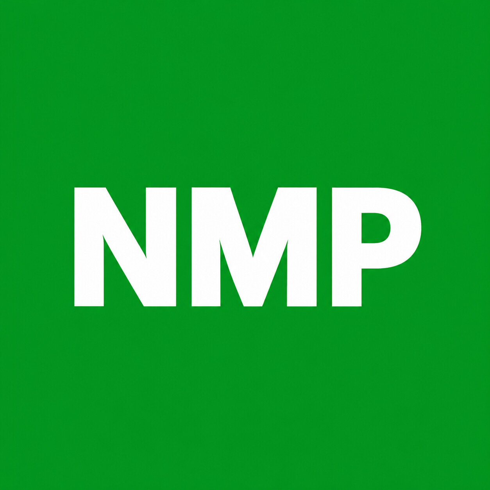

# Naver Mail Plugin

<p align="center"></p>

**NMP**는 각 사용자가 자기 PC나 서버에 설치하고, 자기 네이버 메일을 자기 ChatGPT 또는 MCP 클라이언트에서 사용하는 오픈소스입니다. 네이버 자격증명을 받는 중앙 서비스는 운영하지 않습니다.

로컬 MCP는 **stdio**, 웹 ChatGPT는 **개인 OpenAI Secure MCP Tunnel**로 연결합니다. 공개 `/mcp`, 네이버 OAuth 앱, 로그인 웹사이트, 도메인과 포트포워딩이 필요하지 않습니다. 설치한 장비와 Tunnel 클라이언트는 사용 중 켜져 있어야 합니다.

## 설치

[플러그인 설치 도우미 ZIP 다운로드](https://github.com/kdHyeok/NMP/releases/latest/download/nmp-setup.zip) ·
[개인 플러그인 패키지 생성·설치 안내](docs/plugin-distribution.md)

공용 ZIP은 ChatGPT에서 설치를 안내하는 스킬 패키지입니다. 각 사용자가 자기 서버와 Tunnel을 설정한 뒤
`nmp package --connection "<자신의 ChatGPT MCP 연결 상세 URL>"`로 개인 연결용 ZIP을 만듭니다.
서버 비밀번호와 API 키는 패키지에 포함하지 않습니다.

[uv](https://docs.astral.sh/uv/getting-started/installation/)와 Git을 먼저 설치합니다. Python 3.12를 권장합니다. Linux 서버 모드는 Docker Engine과 Docker Compose도 필요합니다.

```bash
git clone https://github.com/kdHyeok/NMP.git
cd NMP
```

| 목적 | Linux/macOS | Windows PowerShell |
|---|---|---|
| 로컬 MCP 클라이언트 | `bash scripts/install.sh local` | `.\scripts\install.ps1 -Mode local` |
| 이 PC에서 웹 ChatGPT 연결 | `bash scripts/install.sh tunnel` | `.\scripts\install.ps1 -Mode tunnel` |
| Linux 서버 상시 실행 | `bash scripts/install.sh server` | Linux 서버에 SSH 접속해서 왼쪽 명령 실행 |

설치기는 네이버 메일 주소와 **앱 비밀번호**를 입력받습니다. Tunnel/서버 모드는 개인 Tunnel ID와 해당 Tunnel의 런타임 키도 입력받습니다. 비밀값은 숨김 입력을 사용하며 채팅에 붙여 넣지 않습니다. 기존 설정이 있으면 재입력 없이 보존합니다.

- 로컬 MCP: 생성된 `.nmp/mcp.json`의 `mcpServers` 항목을 사용하는 클라이언트 설정에 병합합니다. 기존 설정 전체를 덮어쓰지 마세요.
- PC의 웹 ChatGPT: 설치 후 `uv run --frozen nmp tunnel`을 실행해 둡니다. 공식 Tunnel 실행 파일이 없으면 v0.0.17 아카이브의 체크섬을 검사해 설치합니다.
- Linux 서버: 설치기가 이미지를 빌드하고 Compose를 실행합니다. 부팅 시 Docker도 실행되게 설정합니다.

자세한 절차: [로컬·웹 ChatGPT 연결](docs/chatgpt-setup.md), [Linux 서버 운영](docs/server-deployment.md).

## 연결 정보와 검사

```bash
uv run --frozen nmp info
uv run --frozen nmp doctor
```

`info`는 로컬 MCP 설정 경로와 ChatGPT에 등록할 Tunnel ID를 출력합니다. 비밀번호와 런타임 키를 출력하는 명령은 제공하지 않습니다. `doctor`는 암호화 파일 읽기와 stdio 도구 등록을 검사하고 POSIX에서는 파일 권한도 확인합니다. 실제 로그인 성공을 뜻하지 않습니다.

웹 ChatGPT에서는 사용자 지정 MCP 추가 시 **Connection: Tunnel**, 자신의 Tunnel ID를 선택합니다. 단일 소유자 전용 stdio 구성의 Authentication은 **No authentication**입니다. 이 구성의 접근 통제는 OpenAI 계정과 Tunnel 권한입니다. 자신의 Platform 조직과 대상 ChatGPT 워크스페이스 연결 및 사용자 지정 MCP 권한이 필요합니다. **Tunnel을 다른 사용자에게 공유하지 마세요.**

공개 GitHub 저장소와 개인 Tunnel의 공개 범위는 별개입니다. 각 사용자가 자신의 Tunnel을 준비합니다. 이 구성은 개인 연결용이며 ChatGPT 공개 플러그인 디렉터리 제출용은 아닙니다. [OpenAI 공식 안내](https://developers.openai.com/api/docs/guides/secure-mcp-tunnels).

## 메일 도구

| 도구 | 기능 |
|---|---|
| `get_profile` | 계정 프로필과 메일 수 |
| `search_emails` | 발신자·수신자·제목·날짜·읽음 상태로 검색 |
| `read_email` | 본문·헤더·첨부 정보 읽기 |
| `read_thread` | Message-ID 기반 대화 조회 |
| `list_folders` | 메일함 목록 조회 |
| `create_draft` | 네이버 메일함에 초안 저장 |
| `list_drafts` | 초안 목록 조회 |
| `send_email` | 정확한 수신자·내용 확인 후 발송 |
| `download_attachment` | 첨부파일을 base64로 반환 |

예: “네이버 메일에서 제목에 회의가 들어간 최근 메일 5개를 찾아서 요약해줘.”

초안 저장은 실제 계정을 변경합니다. 발송은 MCP 확인 창에서 승인한 경우에만 실행하며 거절·취소·확인 미지원이면 보내지 않습니다. 오류나 부분 발송을 자동으로 재시도하지 않습니다.

## 비밀정보와 운영 경계

- 메일 주소·앱 비밀번호·Tunnel 키는 `.nmp/config.enc`에 Fernet 인증 암호화로 저장합니다. 별도 `.nmp/key`가 필요합니다.
- POSIX는 전용 디렉터리 700, 파일 600을 적용합니다. Windows는 현재 사용자와 SYSTEM의 DACL을 설정합니다.
- 로컬 MCP 설정에는 실행 경로만 포함합니다. Docker 설정에는 비밀값 대신 읽기 전용 설정 경로만 포함합니다.
- Tunnel 키는 실행 중인 Tunnel 자식 프로세스 환경으로만 전달합니다. 네이버 앱 비밀번호는 도구 인자나 환경변수에 넣지 않고 실행 시 복호화합니다.
- 키와 암호문이 같은 장비에 있으므로 이 암호화는 호스트 root/관리자나 장비 전체 침해를 막지 못합니다. 백업에서도 둘을 함께 보호하세요.
- 기본 실행에 공개 메일 HTTP API는 없습니다. health/admin은 loopback 전용이며 Docker 포트도 게시하지 않습니다.
- 기존 환경변수 또는 비밀번호 파일을 사용하는 stdio 실행은 호환성을 위해 유지합니다. `NMP_CONFIG_DIR`을 설정하면 암호화 설정만 사용하고 오류 시 기존 환경변수로 우회하지 않습니다.
- 이전 평문 `.env`·`.secrets/`는 자동 삭제하지 않습니다. 새 연결 확인 후 직접 정리하세요.

메일 전체 크기는 25MiB, 첨부 하나는 5MiB, 도구 결과는 JSON 재인코딩 기준 8MiB까지입니다. 메일 본문과 첨부파일의 지시문은 외부 데이터로 취급합니다.

## 개발과 검증

공식 Python MCP SDK v2를 사용하며 잠금 버전은 2.3.0입니다. 패키지 이름과 기존 실행 명령 `naver-mail-mcp`는 유지합니다. 이 수정본은 저장소에서 설치하며 PyPI에 별도로 배포하지 않았습니다.

```bash
uv sync --frozen
uv run --frozen python -B -m unittest tests.test_unit tests.test_setup tests.test_plugin_package -v

docker build --target test -t nmp:test .
docker run --rm --network none nmp:test

docker build --target runtime -t nmp:local .
uv run --frozen python -B -m tests.smoke_compose
```

검사 결과와 실제 계정 미검증 범위는 [테스트 기록](docs/test-results.md)에 구분합니다. Windows/Linux/macOS용 오프라인 CI를 제공하며 Linux 컨테이너 검증을 다른 OS의 실기 검증으로 간주하지 않습니다.

## 출처와 라이선스

[chanmuzi/naver-mail-mcp](https://github.com/chanmuzi/naver-mail-mcp)를 기반으로 개인 ChatGPT 연결, 입력 검증·발송 확인, 공식 SDK v2와 설치·운영 도구를 적용했습니다. 원본 저작권과 [MIT 라이선스](LICENSE)를 유지합니다.
